

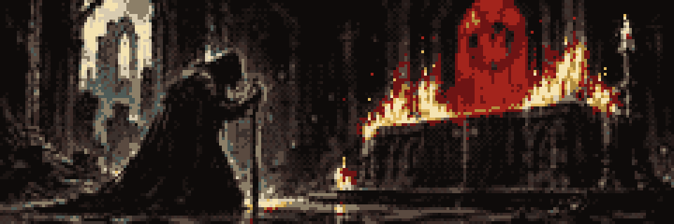

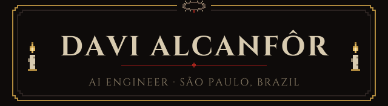

 

<a href="https://www.linkedin.com/in/davi-alcanfor/">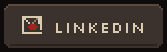</a>
<a href="https://medium.com/@alcanfordavi">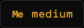</a>

## About

I'm an AI engineer at **PicPay**, working on LLM agents, machine and deep learning, and forecasting. I study at **Instituto J&F**. I speak Portuguese, English, Spanish and French.

## Relics

**Languages**

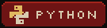  

**Agents and models**

   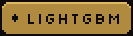

**Services and storage**

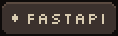 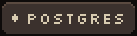 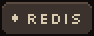 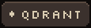 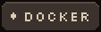

## Inventory

A ledger that writes itself. It pulls notebooks from NotebookLM, lets three agents sort their sources by topic, and leaves them as notes in an Obsidian vault. Once there were five agents; two were replaced by a regex and a single question.

Python · LangGraph · NotebookLM · Obsidian

A steward of money and hours. A router reads each request and sends it to the treasurer or to the keeper of the calendar, while guardrails stand watch at the way in and the way out.

Python · LangGraph · LangChain · Postgres · MongoDB · Redis · Qdrant

<a href="https://github.com/DaviAlcanfor/hybridts">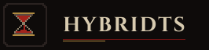</a>

Prophet reads the long line of a series: trend, season, holiday. What it misses is handed to XGBoost or LightGBM, which mend the residue. Published on PyPI.

Python · Prophet · LightGBM · XGBoost · <code>pip install hybridts</code>

Named for the guardian of the gates. It knocks on every port, waits for an answer, and records the banner of whatever replies. Meant only for doors you own.

Rust · Tokio · async TCP

<a href="https://github.com/Frigus-Interdisciplinar/frigus-ai">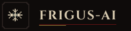</a>

The voice of Frigus, which keeps watch over pantry, fridge and freezer. Specialists answer for stock, shopping, recipes and household spending; a judge weighs each reply before it is spoken.

Python · LangGraph · Gemini · Groq · Qdrant

## Beyond the code

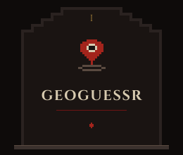
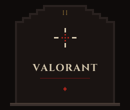
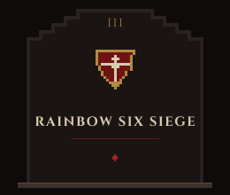

Also: video editing.

## Activity



