  

Multi-agent assistant for the Frigus food app, with RAG, guardrails and an LLM-as-judge. Lead developer.

<b>stack</b>&nbsp; langgraph · rag · qdrant · neo4j &nbsp;&nbsp; <b>repo</b>&nbsp; <a href="https://github.com/Frigus-Interdisciplinar/frigus-ai">github.com/Frigus-Interdisciplinar/frigus-ai</a>

Personal finance and calendar assistant built as a multi-agent system, live in production.

<b>stack</b>&nbsp; langgraph · postgres · redis · qdrant &nbsp;&nbsp; <b>repo</b>&nbsp; <a href="https://github.com/DaviAlcanfor/assessor-ai">github.com/DaviAlcanfor/assessor-ai</a> &nbsp;&nbsp; <b>demo</b>&nbsp; <a href="https://assessor-ai.fastapicloud.dev/docs">assessor-ai.fastapicloud.dev/docs</a>

Predicts the VALORANT Champions 2026 winner: dynamic Elo features, XGBoost tuned with Optuna and 10k Monte Carlo bracket simulations.

<b>stack</b>&nbsp; xgboost · optuna · monte carlo &nbsp;&nbsp; <b>repo</b>&nbsp; <a href="https://github.com/DaviAlcanfor/champions-prediction-vlrdevapi">github.com/DaviAlcanfor/champions-prediction-vlrdevapi</a>

Time series forecasting library: Prophet for trend, gradient boosting for the residuals. Published on PyPI.

<b>stack</b>&nbsp; prophet · xgboost · lightgbm · pypi &nbsp;&nbsp; <b>repo</b>&nbsp; <a href="https://github.com/DaviAlcanfor/hybridts">github.com/DaviAlcanfor/hybridts</a>

Syncs NotebookLM notebooks into structured Obsidian notes through a multi-agent LLM pipeline.

<b>stack</b>&nbsp; langgraph · llm · obsidian &nbsp;&nbsp; <b>repo</b>&nbsp; <a href="https://github.com/DaviAlcanfor/nb2ob">github.com/DaviAlcanfor/nb2ob</a>

Fast async TCP port scanner with per-service banner grabbing.

<b>stack</b>&nbsp; rust · tokio &nbsp;&nbsp; <b>repo</b>&nbsp; <a href="https://github.com/DaviAlcanfor/anubis">github.com/DaviAlcanfor/anubis</a>

 

