

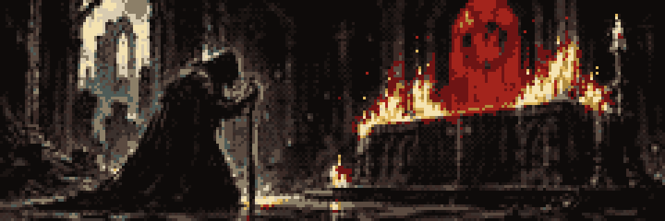

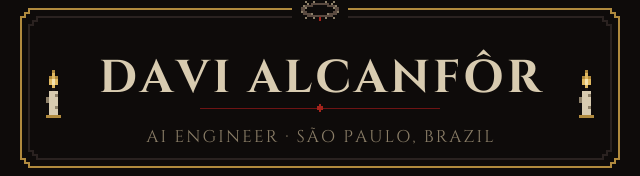

  

<a href="https://www.linkedin.com/in/davi-alcanfor/">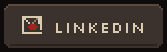</a>
<a href="https://medium.com/@alcanfordavi">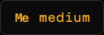</a>

 

I'm an AI engineer at **PicPay**, where I build LLM agents and work on machine learning, deep learning and forecasting. I study at **Instituto J&F**, and I speak Portuguese, English, Spanish and French.

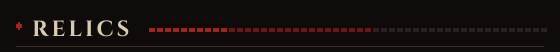

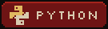 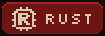 

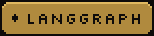  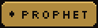 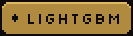

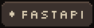 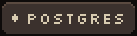 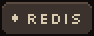 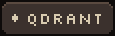 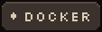

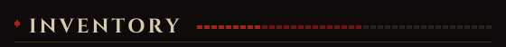

> *A ledger that writes itself. It draws study notebooks out of NotebookLM, lets three agents sort them by subject, and sets them down in Obsidian. Two costlier scribes were dismissed and replaced with regex.*
>
> `Python` · `LangGraph` · `Obsidian REST API`

<a href="https://github.com/DaviAlcanfor/assessor-ai">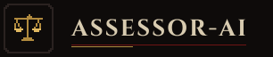</a>

> *A steward of coin and hours. A router hears each request and sends it to the ledger or the calendar. Guards stand at both gates.*
>
> `LangGraph` · `Postgres` · `MongoDB` · `Redis` · `Qdrant`

<a href="https://github.com/DaviAlcanfor/hybridts">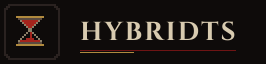</a>

> *Prophet reads the long tide. A gradient booster mends what it missed. Published on PyPI, and it answers to `fit` and `predict` like any familiar tool.*
>
> `Python` · `Prophet` · `LightGBM` · `XGBoost`

> *Guardian of the gates. It knocks on every port at once and writes down whoever answers, and what they say.*
>
> `Rust` · `Tokio` · `clap`

<a href="https://github.com/Frigus-Interdisciplinar/frigus-ai">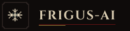</a>

> *Keeper of the cold larder. It counts what remains, warns of what is spoiling, and suggests what can still be made of it. A judge weighs every answer before it is given.*
>
> `LangGraph` · `FastAPI` · `Qdrant` · `Groq` · `Gemini`

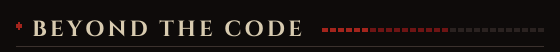

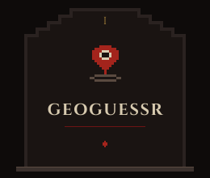
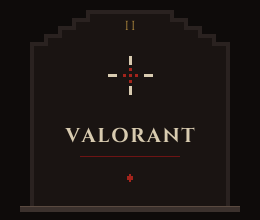
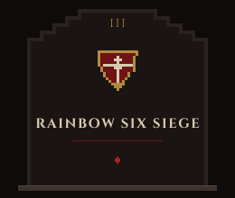

<em>And video editing, when the night allows.</em>

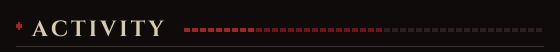



